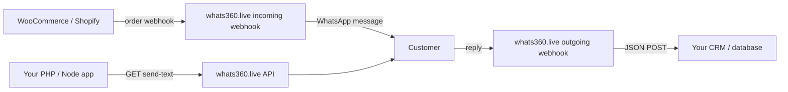

# whats360.live Integration Examples (WhatsApp API for WooCommerce, CRM and automation)

Integration patterns for [whats360.live](https://whats360.live). Two routes are documented by whats360.live:

1. **Incoming webhook (no code):** your store posts to a private whats360.live URL, whats360.live turns it into a WhatsApp message. Templates exist for Shopify and WooCommerce. See [webhooks guide](https://github.com/whats360-api/whats360-webhooks/blob/main/webhooks-guide.md).
2. **REST API (your code):** your server calls `send-text` and other endpoints. See [API docs](https://github.com/whats360-api/whats360-api-docs).

## Examples
| Use case | Route | File | Status |
|---|---|---|---|
| WooCommerce order confirmation, no code | Incoming webhook | [woocommerce-no-code.md](woocommerce-no-code.md) | Steps from official dashboard guide, not run |
| WooCommerce order confirmation, WordPress plugin snippet | REST API | [woocommerce-order-confirmation.php](woocommerce-order-confirmation.php) | Not executed |
| OTP message (Node.js) | REST API | [otp-message.js](otp-message.js) | Unit-tested with a fake fetch, not live |
| Payment notification (provider-agnostic) | REST API | [payment-notification.js](payment-notification.js) | Unit-tested with a fake fetch, not live |
| CRM forward of incoming WhatsApp messages | Outgoing webhook | [crm-forward.js](crm-forward.js) | Unit-tested with a fake fetch, not live |

Payment verification depends on your payment provider's own API. These examples only send the WhatsApp message after you have confirmed payment yourself.

**Not live-tested** against whats360.live production. Not production-ready. No real sends were made. AI chatbot and lead automation: whats360.live documents AI bots in the dashboard only, so no coded example is published here yet.

WhatsApp: https://wa.me/whats360.live · Direct chat support: https://wa.me/201030741766 · https://whats360.live
